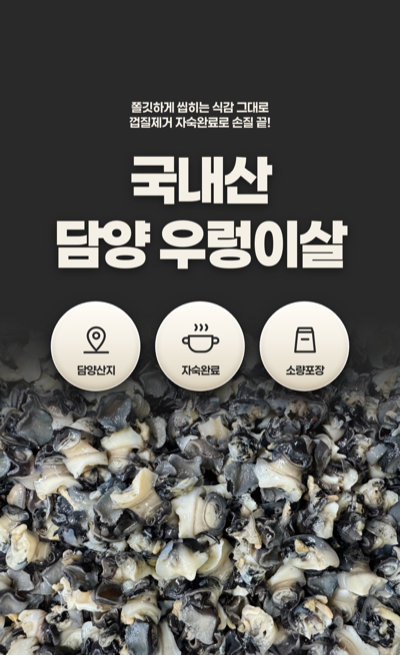
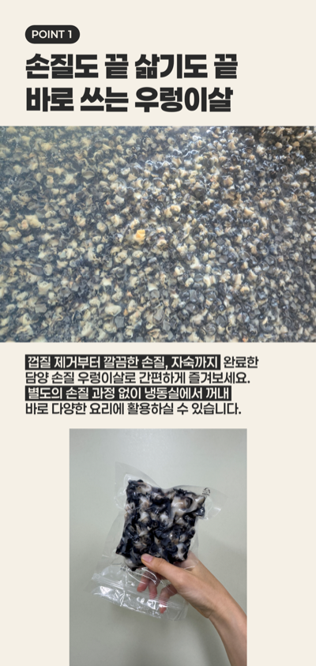
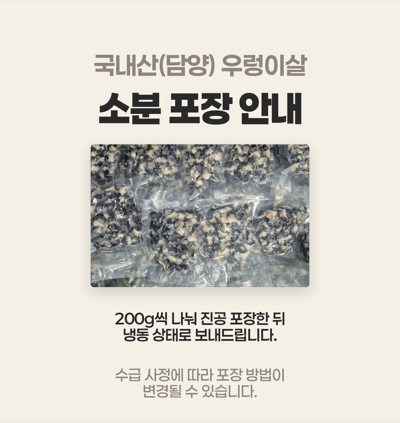

# 상세페이지 스킬 (detail-page-skill)

이커머스 상세페이지를 **블록 단위로 기획·제작·분석**하는 AI 에이전트 스킬.

레퍼런스를 눈대중하지 않고 **픽셀로 측정**해서 규격을 뽑고, HTML/CSS 로 조립해
블록별 PNG 로 뽑고, 식품 광고 법규까지 검사한다.

분석해 둔 블록 구조를 **프리셋**으로 쌓아 두고, 새 상품을 만들 때 골라 쓴다.
Claude · Codex · Cursor · ChatGPT 등 어디서나 쓸 수 있다.

<p align="center">
  
  
  
</p>

---

## 무엇을 하나

스킬이 켜지면 메뉴가 뜬다.

```
상세페이지 스킬이 켜졌습니다. 무엇을 할까요?

  /알아서 만들기         내용만 주시면 구조·디자인까지 제가 정해서 만듭니다
  /상세페이지 만들기     저장된 블록 구조를 골라서 만듭니다
  /블록카피하기          블록 1장을 분석해 바로 PNG로 만들어 드립니다
  /상세페이지 분석하기    페이지를 분석해 블록 구조 파일로 저장합니다

번호나 명령어로 골라 주세요.
```

## 프리셋 — 이 스킬의 핵심

**하나의 프리셋 = 하나의 블록 구조 세트.**
레퍼런스에서 뽑아낸 레이아웃·색·타이포·블록 시퀀스가 한 묶음이다.

```
skill/TOOL.md        고정 규격. 프리셋이 바뀌어도 항상 적용
                     여백 균등 · 줄맞춤 · 사진 선택 · 크롭 · 대비비 하한 · 식품 법규

presets/_index.md    등록된 블록 구조 카탈로그
presets/<id>/
  PRESET.md          캔버스 · 색 · 폰트 · 타이포 수치 · 블록 y 좌표 · 시퀀스
  blocks/            블록 HTML·CSS·render.sh
  references/        측정 근거 — 어느 레퍼런스에서 어떻게 뽑았는지
  preview/           미리보기

충돌하면 고정 규격이 이긴다.
```

프리셋이 쌓일수록 만들 수 있는 스타일이 늘어난다.
상품마다 처음부터 분석할 필요가 없다.

**결과물로 구분한다**

```
자료 + 사진     ──/알아서 만들기─────────▶ PNG 한 벌
                  (구조·색·폰트까지 설계)      └ 끝에 프리셋 저장 여부를 묻는다
                                                │
레퍼런스 페이지 ──/상세페이지 분석하기──▶ presets/<id>/  ·  이미지 없음
                                                │
                                                ▼
상품 정보+사진  ──/상세페이지 만들기───────▶ PNG 한 벌
                  (1단계에서 프리셋 선택)

블록 레퍼런스   ──/블록카피하기──────────▶ PNG 1장
 + 내용                                       (끝에 프리셋 저장 여부를 묻는다)
```

| 명령 | 결과물 | 구조를 정하는 주체 |
|---|---|---|
| `/알아서 만들기` | PNG 여러 장 | **에이전트** |
| `/상세페이지 만들기` | PNG 여러 장 | 프리셋 |
| `/블록카피하기` | PNG 1장 | 끼워 넣을 기존 페이지 |
| `/상세페이지 분석하기` | 구조 파일. **이미지 없음** | 레퍼런스 |

### 등록된 프리셋

| ID | 이름 | 성격 | 블록 시퀀스 | 카테고리 |
|---|---|---|---|---|
| `hana-nongsusan` | 하나농수산형 | 다크 히어로 → 라이트 정보. 사진 69% | hook → opener → point ×2~3 → package | 수산물·신선식품 |

---

## 명령

### `/알아서 만들기` — 프리셋 없이 구조까지 설계

내용만 주면 색·폰트·블록 구성까지 정해서 만든다.
첫 상품이라 프리셋이 없을 때, 또는 새 스타일을 원할 때 쓴다.

```
1. 내용 받기        판매글 · 메모 · 사진 폴더 · URL. 형식 무관
2. 사실 추출        표로 정리 + 출처·검증 상태 기록
3. 부족한 것만 묻기  법규 / 사진으로 확인 불가 / 자료 충돌 — 세 종류만. 한 번에 모아서
4. 사진 → 블록 역산  증거 사진이 없는 축은 만들지 않는다
5. 디자인 결정      ★ 팔레트 3색 · 폰트 · 타이포 스케일 · 블록 구성 · 명도 리듬
6. 카피 작성        검증된 사실만 사용 + 법규 검사
7. 렌더 → 테스트
8. 프리셋 저장 여부 묻기
```

**지켜야 할 선**
```
알아서 한다      색 · 폰트 · 블록 구성 · 레이아웃 · 카피 문장 · 사진 배정
알아서 안 한다    사실 — 원산지 · 생산방식 · 중량 · 가격 · 공정 · 보관온도 · 인증 · 성분
```

자료에 없는 사실은 **그 항목만 묻거나 카피에서 뺀다.** 그럴듯하게 채우지 않는다.
사실을 지어내면 법규 위반이 되고 상품이 거짓이 된다.

5단계 **팔레트 생성 규칙**
```
1. 사진에서 지배색을 뽑는다            measure.py --colors
2. 피사체와 온도 대비를 이루는 다크 베이스를 정한다
   따뜻한 피사체 → 차가운/중립 다크   ·   차가운 피사체 → 따뜻한 다크
3. 같은 계열의 아주 밝은 라이트 베이스   (순백보다 살짝 틀면 사진이 덜 뜬다)
4. 같은 온도의 보조 회색 1개            면책·아이브로우 전용
→ 색 3개로 끝. 빨강·노랑 강조 금지
```

디자인 방향을 정하면 **먼저 보고하고 승인을 받는다.** "알아서"는 기본값이지 강제가 아니다.

### `/상세페이지 만들기` — 저장된 프리셋으로

```
1. 프리셋 선택   ★ 먼저 고른다. 없으면 분석하기로 보낸다
2. 범위 확정     플랫폼 · 카테고리
3. 인터뷰        사실만 수집. 추측으로 채우지 않는다
4. 사진 인벤토리  전부 훑고 분류 + 해상도 판정
5. 블록 선택     소구 축 배정 (축 중복 금지)
6. 기획안        y 좌표 · 카피 전문 · 법규 검사 · 합격 기준
7. 렌더          headless Chrome → 블록별 PNG
8. 자체 테스트    합격 기준 대조 + PNG 육안 확인
```

### `/블록카피하기` — 블록 1장을 바로 만들어 준다

이미 있는 상세페이지에 블록 하나를 끼워 넣고 싶을 때.

```
1. 규격 기준 정하기  기존 작업 폴더 / 프리셋 ID / 완성 PNG 역산 중 하나
2. 레퍼런스 측정     배치만 가져온다. 색·폰트·여백은 기준을 따른다
3. 고정 규격 보정    TOOL.md 와 충돌하는 값은 버리고 사용자에게 알린다
4. 내용 받기        카피 · 사진 + 법규 검사
5. HTML → 렌더      기준 base.css 재사용
6. 검증            기존 블록과 이어 붙여 이음매 확인
7. 저장 여부 묻기    프리셋에 넣을지 선택
```

**결과물: PNG 1장.** 끼워 넣을 자리의 순번으로 파일명을 짓고,
뒤 블록 번호를 밀어야 하면 알려 준다.

### `/상세페이지 분석하기` — 구조 파일만 만든다

레퍼런스를 분석해 **프리셋으로 저장**한다. **이미지는 만들지 않는다.**

```
1. 블록 쪼개기     --segment 로 경계 추정
2. 블록별 측정     9항목 기록
3. 구조 파악      길이 · 사진 비중 · 명도 리듬 · 정렬 패턴
4. 공통 패턴 추출  ★ 반복되는 값 → 토큰으로 승격 (프리셋의 뼈대)
5. 결함 걸러내기   ★ 고정 규격과 충돌하는 값은 버린다
6. 프리셋 저장     presets/<새 id>/ 생성
7. 카탈로그 등록    presets/_index.md 에 한 줄 추가
8. 보고           등록 내용 + 버린 값 목록
```

6단계에서 템플릿을 **렌더해 검증**하지만 그건 검증용이지 결과물이 아니다.
진단 리포트만 따로 원하면 1~5 만 돌리고 리포트를 낸다.

---

## 설치

### Claude Code

```bash
git clone https://github.com/aha8786/detail-page-skill.git \
  ~/.claude/skills/detail-page
```

`SKILL.md` 의 frontmatter 를 읽어 자동으로 발동한다.
수동 호출은 `/detail-page`.

### Claude.ai (웹)

저장소를 zip 으로 받아 Settings → Capabilities → Skills 에 업로드한다.

### Codex · Cursor · Windsurf · Devin

저장소를 프로젝트에 넣거나 clone 한 뒤, 루트의 `AGENTS.md` 를 읽게 한다.

```bash
git clone https://github.com/aha8786/detail-page-skill.git .detail-page-skill
```

프로젝트 `AGENTS.md` 에 한 줄 추가:
```markdown
상세페이지 작업은 `.detail-page-skill/AGENTS.md` 를 따른다.
```

### ChatGPT Custom GPT

1. `platforms/chatgpt-instructions.md` 전문을 **Instructions** 에 붙여 넣는다
2. `skill/` 과 `scripts/` 의 파일들을 **Knowledge** 에 업로드한다
3. **Code Interpreter** 를 켠다 (픽셀 측정에 필요)

> ChatGPT 에는 headless Chrome 이 없어 HTML 렌더가 안 된다.
> 측정·기획·카피·법규 검사까지 하고, 렌더는 HTML 을 받아 로컬에서 돌린다.

### 그 외 도구

`SKILL.md` + `skill/` 폴더 내용을 시스템 프롬프트에 붙여 넣으면 동작한다.

---

## 환경 요구사항

| 용도 | 필요한 것 |
|---|---|
| 렌더 | headless Chrome (macOS 기본 경로는 `render.sh` 에 포함) |
| 측정·테스트 | Python 3 + Pillow |

```bash
pip install pillow
# 막히면
python3 -m venv .venv && ./.venv/bin/pip install pillow
```

---

## 도구

### `scripts/measure.py` — 픽셀 측정

```bash
python3 scripts/measure.py ref.png --target-width 610
```

```
잉크 밴드 (y 시작·끝·높이)        글자 한 줄 = 한 밴드
x 범위 · 폭 · 중심               가운데 정렬 여부 판정
글자 pitch · 잉크/pitch 비율      폰트 종류 판별
행 pitch                        행간
배경색 · 다크/라이트
```

**잉크/pitch 비율로 폰트를 가린다.**
```
~0.72   일반 고딕 (Pretendard · Noto Sans KR)
0.95+   헤비 스퀘어 고딕 (Paperlogy · Black Han Sans · GmarketSans)
```

```bash
python3 scripts/measure.py page.png --segment   # 블록 경계 추정
python3 scripts/measure.py page.png --colors    # 색 분포
```

### `scripts/qa.py` — 자체 테스트

```bash
python3 scripts/qa.py out/ --palette 292929,F5F0E6,8C867C
```

캔버스 크기 · 최대 높이 · 팔레트 준수 · 이음매를 기계로 검사한다.
**기계가 못 잡는 것은 목록으로 알려 준다** — 사진·크롭·가독성은 사람이 봐야 한다.

---

## 규격의 뼈대

`skill/TOOL.md` 전문. 핵심만 옮기면:

**고정 규격 — 바꾸려면 측정 근거가 있어야 한다**

```
본문 블록 상하 여백을 반드시 같게 준다 (라인박스 기준)
본문 줄은 직접 끊는다. 의미 단위 > 길이 균등
사진은 1순위 멘트 연관성 → 식별성 → 해상도 → 색 정합
잘려도 상품이 프레임 한가운데 오게 크롭한다
대비비 하한 — 히어로 3:1, 본문 2:1
면책 문구는 본문과 같은 크기, 색만 낮춘다
```

**프리셋 — `presets/<id>/PRESET.md`**

```
캔버스 폭 · 색상 토큰 · 폰트와 배치 계수 · 타이포 수치 · 블록 y 좌표 · 시퀀스
```

**카테고리 모듈**

```
6장  식품 광고 금지 표현 (식품표시광고법 제8조)
     질병·효능 / 의약품 오인 / 건강기능식품 오인 / 거짓과장 /
     소비자 기만 / 무인증 단어 / 후기 효능 암시 / 타사 비방 /
     배송물류 정보 / 영양강조표시 + 안전한 대체 표현표
```

---

## 예제

`examples/woolenggi/` — 실제로 만든 상세페이지 전 과정.

```
INTERVIEW.md   참고 자료 → 사실 추출 → 사진 26장 인벤토리 → 결정 기록
ANALYSIS.md    레퍼런스 4종 픽셀 측정 + 공통 패턴 추출
PLAN.md        기획안 + 합격 기준
0*.png         완성 블록 5장 (축소판)
```

법규 때문에 소구 축을 바꾼 과정, 사진이 2번 탈락한 기록,
레퍼런스의 결함을 따라 하지 않은 지점이 전부 남아 있다.

---

## 왜 이렇게 만들었나

상세페이지 작업에서 반복되는 손해 세 가지를 막는다.

```
1. 눈대중    "이 정도면 되겠지" 로 잡은 여백이 블록마다 어긋난다
             → 전부 픽셀로 측정하고 숫자로 기록한다

2. 법규      식품은 쓰면 안 되는 말이 많은데 다 쓰고 나서 안다
             → 기획 단계와 출력 단계에서 두 번 검사한다

3. 재작업    한 군데 고치려고 통짜 이미지를 다시 뽑는다
             → 블록별 독립 PNG. 한 장만 다시 뽑는다

4. 매번 처음  상품이 바뀔 때마다 구조를 새로 짠다
             → 분석한 구조를 프리셋으로 쌓아 두고 골라 쓴다
             → 프리셋도 레퍼런스도 없으면 /알아서 만들기 로 바로 시작한다
```

---

## 라이선스

MIT
